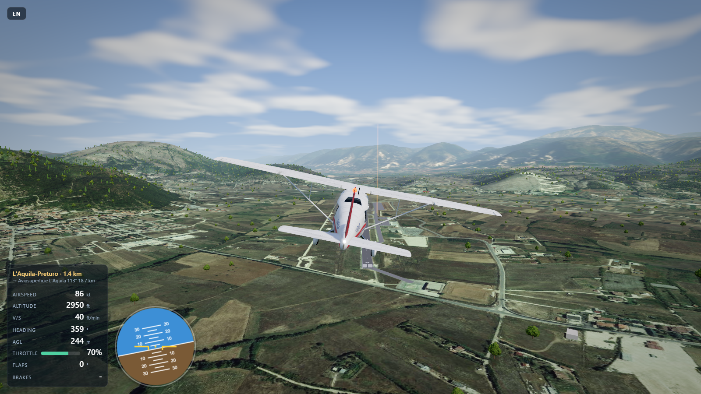
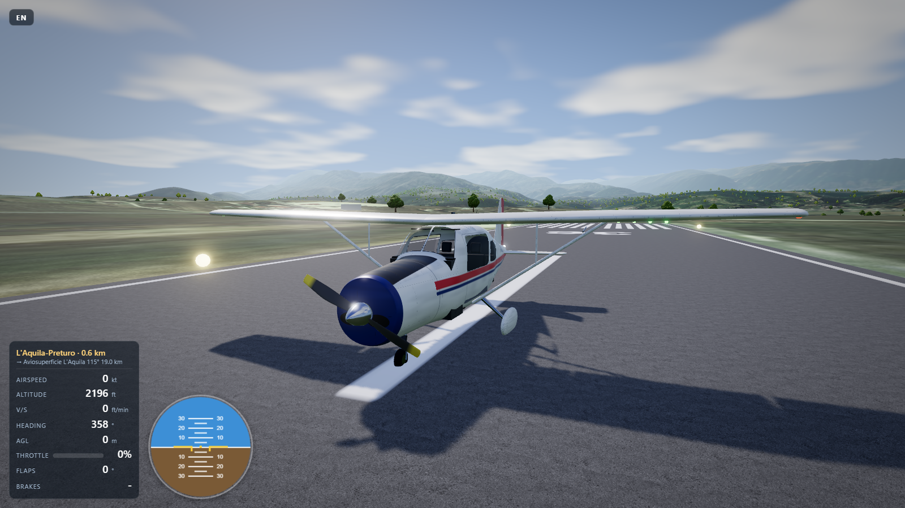
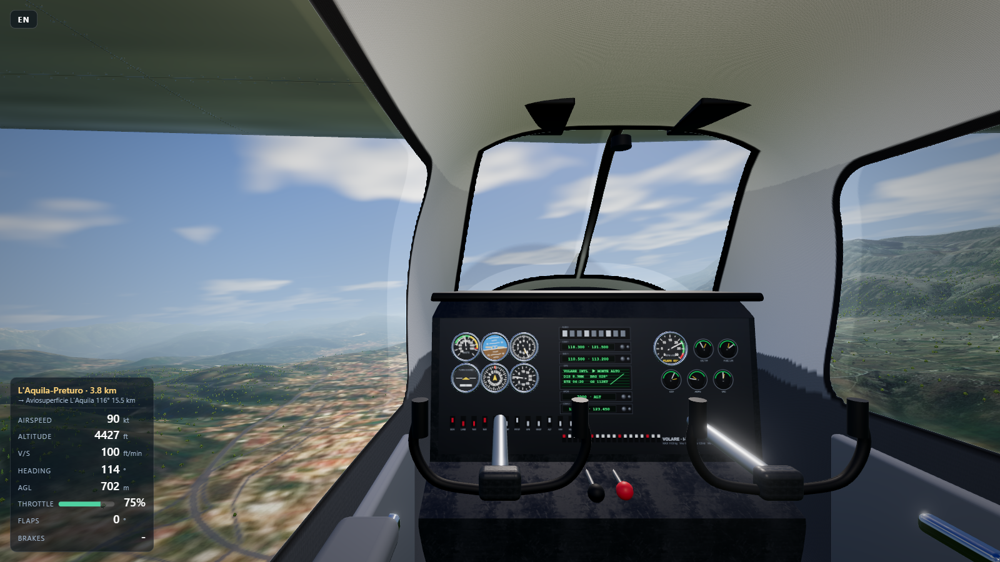
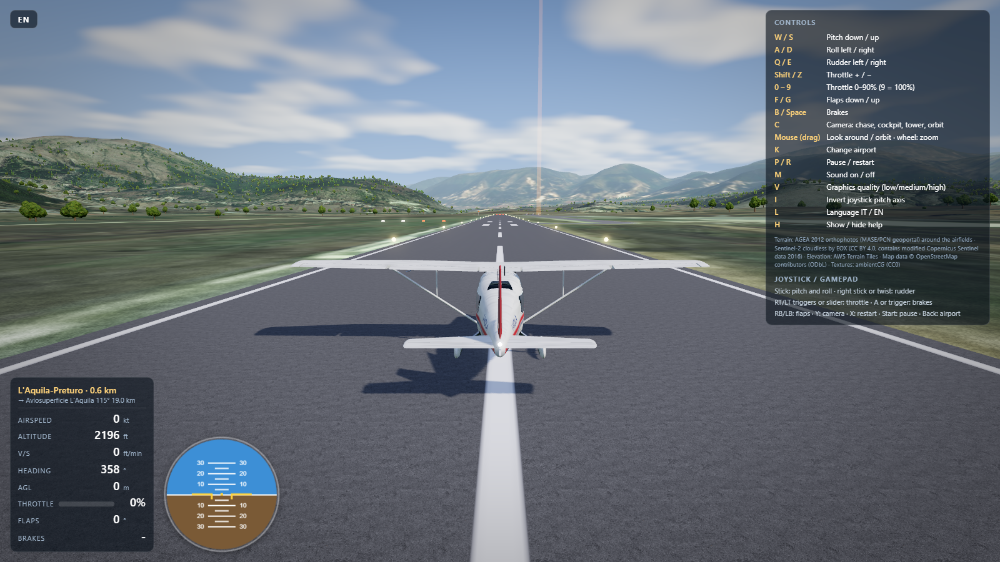
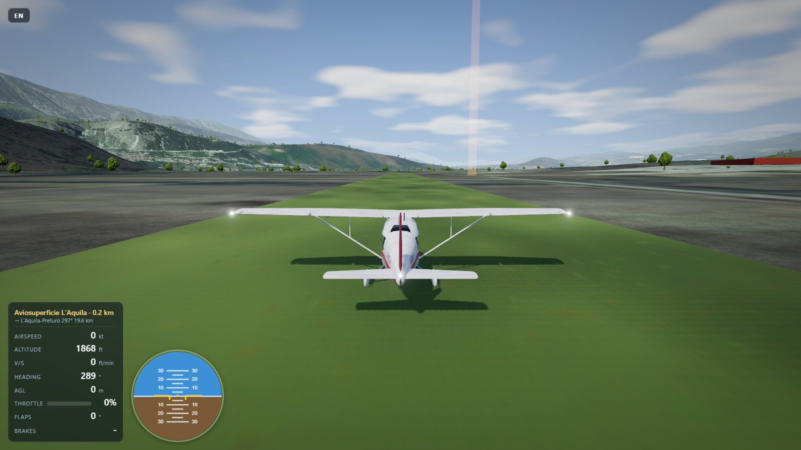
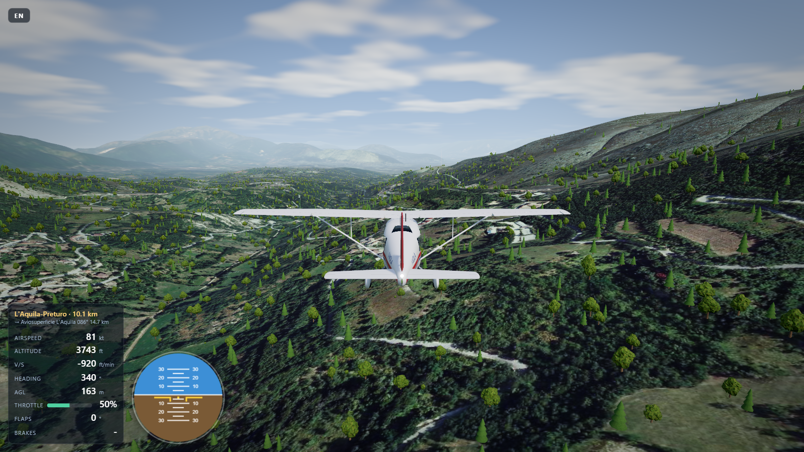
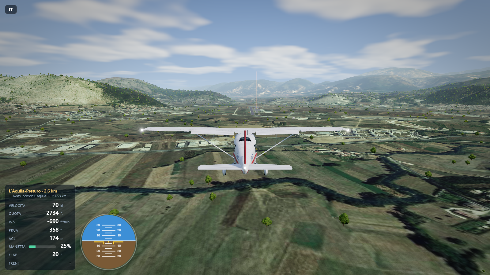

<div align="center">

# ✈️ VolareSIM

**Un simulatore di volo civile realizzato con [Three.js](https://threejs.org/) ed Electron** — pilota un Cessna 172 modellato proceduralmente, con un vero cockpit 3D, sul **territorio reale de L'Aquila**: quote, immagini satellitari Sentinel-2 e aeroporti da OpenStreetMap, dal Gran Sasso alla valle dell'Aterno. Pensato per il desktop: renderer PBR dedicato, risoluzione adattiva e installer per Windows.

[](https://threejs.org/)
[](https://vitejs.dev/)
[](https://www.electronjs.org/)


[English](README.md) · **Italiano**



</div>

## In breve

| | |
|---|---|
| 🛩️ **Una vera cellula, non scatole** | Fusoliera loftata con finestrini aperti e guscio interno, ala rastremata NACA 2412 con diedro, flap, alettoni, equilibratori e timone cernierati, carenature delle ruote, elica svergolata, luci di navigazione e strobo, marche dipinte sulla pelle |
| 🎛️ **Cockpit 3D** | Cruscotto con anemometro, orizzonte, altimetro, prua, variometro e giri motore funzionanti, pila radio e GPS, due volantini collegati, manetta e miscela, sedili, pannelli porta. Guardi attorno col mouse, zoom con la rotella |
| 🌅 **Rendering fisicamente basato** | Pipeline HDR, tone mapping ACES, bloom, riflessi da un ambiente basato sul cielo, ombre del sole agganciate ai texel che cadono perfino dentro l'abitacolo |
| 🗺️ **Territorio reale de L'Aquila** | Un'area di 38 × 38 km con quote vere (Gran Sasso fino a 2.850 m), colori da satellite Sentinel-2, strade, fiumi e laghi da OpenStreetMap e classi di copertura (bosco, urbano, roccia, acqua) stimate dall'immagine. Da vicino texture fotografiche CC0 aggiungono grana |
| 🌲 **Boschi** | Conifere e latifoglie con texture, piazzate dove il satellite vede bosco; gli alberi lontani diventano sagome economiche renderizzate dai veri modelli 3D |
| 🌍 **Due piste reali** | *L'Aquila-Preturo* (LIAP, pista 18/36, 1.410 m, 2.200 ft) e l'*Aviosuperficie L'Aquila* in erba (11/29, 650 m), a 19 km di distanza. Piste, raccordi, piazzali e circa 900 edifici attorno arrivano da OpenStreetMap |
| ⚡ **Prestazioni adattive** | Riconosce le GPU integrate e adatta la risoluzione di rendering (55–100 %) al volo, poi riduce il livello di qualità se serve; con <kbd>V</kbd> scegli a mano |
| 🔊 **Suoni sintetizzati** | Motore a quattro cilindri legato ai giri, elica, vento, rotolamento, cicalino di stallo e tonfo del contatto: nessun file audio |
| 🎮 **Tastiera, mouse, joystick, gamepad** | Funzionano subito grazie alla Gamepad API |
| 🌐 **Italiano e inglese** | Rilevati automaticamente; cambia quando vuoi con <kbd>L</kbd> |

## Screenshot

<table>
  <tr>
    <td width="50%"><br><sub><b>La cellula</b> — fusoliera loftata, finestrini aperti, livrea, ala NACA, carenature ed elica (camera orbita)</sub></td>
    <td width="50%"><br><sub><b>Cockpit 3D</b> — montanti dei finestrini veri, strumenti, pila radio, volantini collegati, manetta e miscela</sub></td>
  </tr>
  <tr>
    <td width="50%"><br><sub><b>Pronti al decollo</b> — HUD, orizzonte artificiale e pannello dei comandi (<kbd>H</kbd>)</sub></td>
    <td width="50%"><br><sub><b>Aviosuperficie L'Aquila</b> — la vera pista in erba (11/29) a 1.870 ft</sub></td>
  </tr>
  <tr>
    <td colspan="2"><br><sub><b>Comune di Lucoli</b> — ortofoto AGEA a 1–3 m/px: strade, tornanti, paesi e campi reali</sub></td>
  </tr>
  <tr>
    <td colspan="2"><br><sub><b>Finale</b> con flap a 20° — qui con l'interfaccia in italiano</sub></td>
  </tr>
</table>

## Installazione (Windows)

Scarica **`VolareSIM-Setup-<versione>.exe`** (installer) oppure **`VolareSIM-Portable-<versione>.exe`** (senza installazione) dalla pagina [Releases](../../releases).
Windows SmartScreen può avvisare che l'app non è firmata: scegli *Ulteriori informazioni → Esegui comunque*. Con <kbd>F11</kbd> vai a schermo intero.

L'app usa la GPU tramite Chromium/ANGLE (Direct3D 11). Sui portatili con due GPU richiede quella ad alte prestazioni; puoi anche forzarla da *Impostazioni di Windows → Grafica*.

### Dal codice sorgente

```bash
git clone https://github.com/marcko80/VolareSIM.git
cd VolareSIM
npm install
npm run app          # compila e avvia l'app Electron
npm run dev          # server Vite (http://localhost:5173) per lo sviluppo
npm run dist         # crea installer e versione portable in release/
npm run fetch-data   # riscarica i dati del terreno reale (serve internet)
node tools/fetch-ortho.mjs   # riscarica le ortofoto a 50 cm attorno ai due aeroporti
```

## Come si vola

1. Premi <kbd>9</kbd> per la manetta al massimo.
2. A circa **55 kt** tira dolcemente (<kbd>S</kbd>) e lascia che l'aereo si stacchi.
3. Sali a **70–80 kt**. Rientra i flap (<kbd>G</kbd>) se li hai usati.
4. Per atterrare riduci la potenza, estendi i flap (<kbd>F</kbd>), vola l'avvicinamento a circa 65 kt e richiama appena sopra la pista. Il simulatore valuta il contatto in base alla velocità di discesa (morbido, buono, duro); un impatto violento o un'ala toccata a terra è un incidente: premi <kbd>R</kbd> per ripartire.

### Comandi

| Tasto | Azione |
|---|---|
| <kbd>W</kbd> / <kbd>S</kbd> | Picchia / cabra |
| <kbd>A</kbd> / <kbd>D</kbd> | Rollio sinistra / destra |
| <kbd>Q</kbd> / <kbd>E</kbd> | Pedaliera sinistra / destra |
| <kbd>Shift</kbd> / <kbd>Z</kbd> | Aumenta / diminuisci la manetta |
| <kbd>0</kbd>–<kbd>9</kbd> | Manetta diretta (0 = minimo, 9 = massimo) |
| <kbd>F</kbd> / <kbd>G</kbd> | Flap giù / su (0°, 10°, 20°, 30°) |
| <kbd>B</kbd> / <kbd>Spazio</kbd> | Freni |
| <kbd>C</kbd> | Cambia camera: inseguimento → cockpit → torre → orbita |
| Trascina il mouse / rotella | Guarda attorno (orbita nella vista orbita) / zoom |
| <kbd>K</kbd> | Passa all'altro aeroporto |
| <kbd>P</kbd> / <kbd>R</kbd> | Pausa / riparti |
| <kbd>M</kbd> | Audio on / off |
| <kbd>V</kbd> | Qualità grafica: bassa / media / alta |
| <kbd>I</kbd> | Inverti l'asse di beccheggio del joystick |
| <kbd>L</kbd> | Lingua EN / IT |
| <kbd>H</kbd> | Mostra / nascondi l'aiuto |

**Gamepad** (mappatura standard): stick sinistro = beccheggio/rollio, stick destro = pedaliera, RT/LT = manetta, A = freni, RB/LB = flap, Y = camera, X = riparti, Start = pausa, Back = aeroporto.
**Joystick** (es. Logitech Extreme 3D): X/Y = rollio/beccheggio, torsione = pedaliera, cursore = manetta, grilletto = freni, pulsanti 3/4 = flap giù/su, pulsante 2 = camera.

## Qualità grafica

| Livello | Pipeline | Pensato per |
|---|---|---|
| **Bassa** | rendering diretto, ombre 1024², distanze di alberi e LOD ridotte, shader del terreno semplificato | GPU deboli o integrate |
| **Media** | target HDR, bloom, ACES, SMAA, ombre 2048² | predefinita sulla maggior parte delle GPU |
| **Alta** | come Media con MSAA 4×, vignettatura e grading, ombre 4096², ombre degli alberi vicino all'aereo, terreno al massimo dettaglio | GPU di fascia alta (predefinita su RTX / Radeon RX 5000+) |

Misurato su un portatile ibrido a 1920 × 1080 con `node tools/perf.mjs` (NVIDIA GTX 1050): in Bassa 60 fps, in Media 46–60 fps e in Alta circa 35–42 fps. Il simulatore riconosce la GPU, chiede a Windows quella ad alte prestazioni e adatta da solo la risoluzione di rendering tra il 55 % e il 100 % per mantenere il frame rate; l'HUD resta nitido. Con <kbd>V</kbd> scegli il livello.

## Come funziona

| Area | Dettagli |
|---|---|
| **Dinamica di volo** (`src/flight.js`) | Passo fisso a 120 Hz. 1100 kg, ala da 16,2 m², 135 kW con rendimento dell'elica 0,78 e spinta statica di 3,4 kN. Pendenza della portanza 5 per radiante, stallo a 17° di incidenza con calo morbido dopo lo stallo; i flap spostano l'angolo di portanza nulla e aumentano la resistenza. La stabilità in beccheggio cresce vicino allo stallo: si stalla perdendo velocità, non tirando la barra. Carrello triciclo con tre punti di contatto, attrito di rotolamento, freni, sterzo del ruotino. Numeri tipici: corsa di decollo ≈ 250 m, rotazione a 55 kt, salita ≈ 800 ft/min, stallo ≈ 45 kt a flap rientrati, velocità massima ≈ 140 kt. |
| **Cellula** (`src/geometry.js`, `src/aircraft.js`) | Fusoliera = 170 anelli superellittici × 88 segmenti, loftati da keyframe con interpolazione cubica monotona. Ali, coda, deriva e pale dell'elica nascono da un unico costruttore di superfici portanti NACA a 4 cifre con rastremazione, diedro, svergolamento, estremità arrotondate e tratti di bordo d'uscita cernierati, con i perni sulla linea di cerniera. |
| **Finestrini e livrea** (`src/livery.js`) | Un set di texture 2048 × 1024 è calcolato una volta da funzioni di distanza con segno nello spazio della fusoliera: vernice, alfa dei finestrini anti-alias, alfa del vetro, guarnizioni, linee dei pannelli e marche. La stessa maschera buca la pelle esterna e un guscio interno rientrante: la cabina è un volume chiuso in cui si vede dentro e fuori. |
| **Cockpit** (`src/cockpit.js`) | Cruscotto estruso, texture del pannello, sette quadranti su canvas ridisegnati solo quando il valore cambia, ghiere cromate e vetrini, due volantini che ripetono i comandi, manetta, sedili, rivestimenti e una luce d'abitacolo. |
| **Cielo e luce** (`src/sky.js`) | Gradiente atmosferico, disco solare HDR e strato di nubi in un solo fragment shader; lo stesso shader è cotto in una mappa ambiente PMREM per i riflessi. Le ombre del sole sono agganciate ai texel della shadow map per evitare lo sfarfallio. |
| **Dati reali** (`tools/fetch-data.mjs`, `src/data.js`) | Uno script, da eseguire una volta, scarica gli AWS Terrain Tiles (quote), il Sentinel-2 cloudless 2016 di EOX (immagini) e gli elementi di OpenStreetMap via Overpass, li riproietta su una griglia metrica locale centrata sulla pista di LIAP e scrive `public/data/` (griglia di quote 2048², immagine 3072² affilata, classi di copertura 1536² e un JSON OSM). Le foto ad alta risoluzione vengono da `tools/fetch-ortho.mjs` (ortofoto AGEA 2012: 1 m/px attorno a LIAP e sui paesi di Lucoli, 2–3 m/px su 8 km attorno a LIAP, attorno all'aviosuperficie e su tutto il comune di Lucoli), fuse nello shader del terreno sopra la base satellitare. Il gioco li legge all'avvio. |
| **Terreno** (`src/world.js`) | 24 × 24 chunk da 1,6 km su coda a budget (niente scatti in volo), tre LOD con gonne. Il fragment shader prende il colore dal satellite, aggiunge grana di luminanza dalle texture fotografiche CC0, una texture di rumore tileable a 3 scale e normal map da vicino, poi sovrappone strade, acqua, roccia sulle pendenze e neve sopra i 2.300 m. Gli alberi sono istanziati per chunk: modelli 3D vicino, sagome (impostori) più lontano. |
| **Post-processing** (`src/postfx.js`) | EffectComposer: target HDR half-float → bloom → uscita ACES → SMAA oppure MSAA + grading. |
| **Audio / input / i18n** | Sintesi WebAudio (`src/audio.js`), tastiera + Gamepad API (`src/controls.js`), traduzioni IT/EN basate su dizionario (`src/i18n.js`). |

```
VolareSIM/
├── index.html             # struttura di HUD, aiuto e schermata di caricamento
├── src/
│   ├── data.js            # caricamento di quote, copertura e OSM reali
│   ├── main.js            # renderer, camere, ciclo di gioco, qualità adattiva
│   ├── flight.js          # fisica di volo e a terra
│   ├── geometry.js        # loft, profili alari, superfici portanti
│   ├── livery.js          # texture della fusoliera (vernice, finestrini, interno)
│   ├── aircraft.js        # modello del Cessna e animazione
│   ├── cockpit.js         # cockpit 3D
│   ├── world.js           # terreno, alberi, aeroporti
│   ├── sky.js             # shader del cielo, mappa ambiente
│   ├── postfx.js          # post-processing
│   ├── controls.js        # tastiera / gamepad
│   ├── audio.js           # suoni sintetizzati
│   ├── hud.js             # HUD e orizzonte artificiale
│   └── i18n.js            # traduzioni
├── electron/main.cjs      # guscio desktop (flag GPU, schermo intero)
├── tools/                 # fetch-data (terreno reale), screenshot, profiler, benchmark FPS, test di fumo
├── dev/viewer.html        # visualizzatore autonomo del modello dell'aereo
└── .github/workflows/release.yml   # compila l'installer Windows sui tag
```

## Sviluppo

```bash
npm run dev           # server di sviluppo con hot reload (apri /dev/viewer.html per il visualizzatore dell'aereo)
npm run build         # build di produzione in dist/
npm run screenshots   # cattura docs/screenshots tramite Electron
node tools/perf.mjs   # FPS a ogni livello di qualità
node tools/profile.mjs 1920 1080 0 1   # costo di cielo / terreno / alberi / ombre
node tools/smoke.mjs  # decolla, cambia camere/qualità/aeroporto/lingua e segnala errori JS
npm run dist          # installer Windows + versione portable
```

Pubblicando un tag come `v0.5.0`, GitHub Actions compila l'installer e lo allega alla release.

## Roadmap

- Vento e meteo, laghi e fiumi
- Navigazione: waypoint, radioassistenze, un semplice pilota automatico
- Altri aerei (bimotore, jet leggero) e una pipeline per modelli `.glb`
- Altri aeroporti, modalità notturna con finestre e luci di pista accese

## Crediti

Ispirato a [web-flight-simulator](https://github.com/dimartarmizi/web-flight-simulator), reinterpretato per l'aviazione civile. Realizzato con [Three.js](https://threejs.org/), [Vite](https://vitejs.dev/) ed [Electron](https://www.electronjs.org/).

**Dati**: ortofoto © AGEA 2012 (50 cm), dal WMS del Geoportale Nazionale del Ministero dell'Ambiente (nessuna condizione d'uso dichiarata; `tools/fetch-ortho.mjs`), immagini satellitari © [EOX IT Services GmbH](https://s2maps.eu) (Sentinel-2 cloudless 2016, CC BY 4.0, contiene dati Copernicus Sentinel modificati), quote da [AWS Terrain Tiles](https://registry.opendata.aws/terrain-tiles/), dati cartografici © [contributori di OpenStreetMap](https://www.openstreetmap.org/copyright) (ODbL). Le classi di copertura sono una stima automatica e non coincidono ovunque con la realtà. Vedi `public/data/CREDITS.txt`.

Le texture dell'aereo (Metal 012, Leather 026, Carpet 001, Plastic 018 B, Fabric 061) sono CC0 di ambientCG; la pelle della fusoliera (giunzioni dei pannelli, file di rivetti, sporco, vernice scheggiata, strisce della livrea) è generata in uno shader (`src/materials.js`). Le texture di terreno, alberi e piste sono scansioni CC0 di [ambientCG](https://ambientcg.com): Grass 004, Grass 001, Ground 037, Ground 106, Ground 111, Rock 051, Bark 014, Leaf 001, Pine Needles 001 e Asphalt 031 (vedi `public/textures/CREDITS.txt`).
