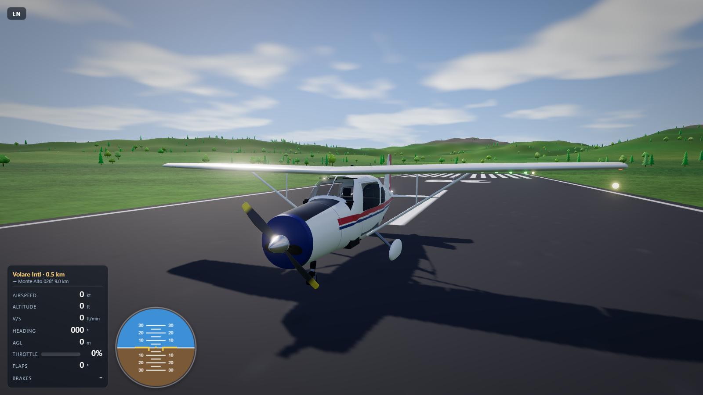
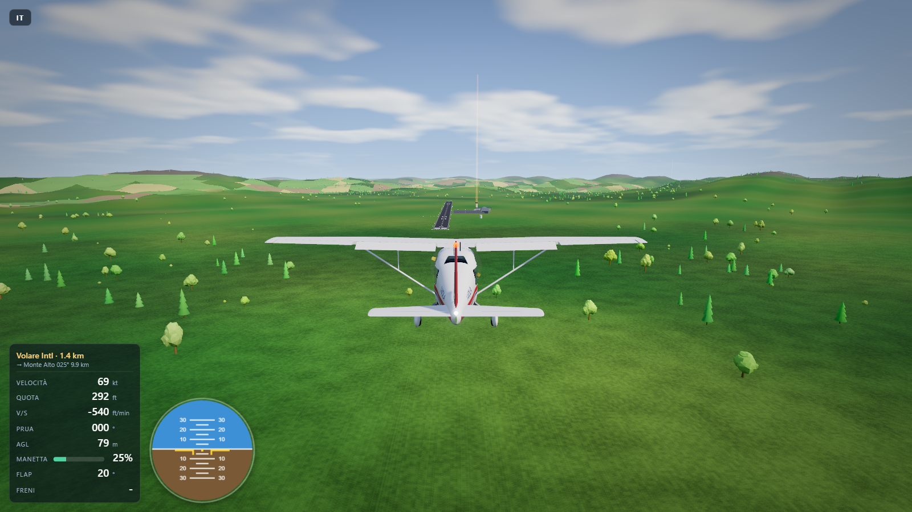

<div align="center">

# ✈️ VolareSIM

**A civil flight simulator built with [Three.js](https://threejs.org/) and Electron** — fly a procedurally modelled Cessna 172, with a real 3D cockpit, between two airports. Desktop-first: a custom PBR renderer, adaptive resolution and an installer for Windows.

[](https://threejs.org/)
[](https://vitejs.dev/)
[](https://www.electronjs.org/)


**English** · [Italiano](README.it.md)


</div>

## Highlights

| | |
|---|---|
| 🛩️ **A real airframe, not boxes** | Lofted fuselage with real window openings and an inner shell, tapered NACA 2412 wing with dihedral, hinged flaps, ailerons, elevators and rudder, wheel pants, twisted propeller, navigation lights and strobes, registration painted on the skin |
| 🎛️ **3D cockpit** | Instrument panel with working airspeed, attitude, altimeter, heading, vertical speed and RPM dials, radio stack and GPS, two linked yokes, throttle and mixture, seats, door panels. Look around with the mouse, zoom with the wheel |
| 🌅 **Physically based rendering** | HDR pipeline, ACES tone mapping, bloom, reflections from an image-based sky environment, texel-snapped sun shadows that even fall inside the cabin |
| ☁️ **Procedural sky and terrain** | Shader sky with drifting clouds and an HDR sun; 26 × 26 km terrain in LOD chunks with farmland patchwork, crop rows, rock on slopes, forests and instanced trees; sea beyond the coast |
| 🌍 **Two airports** | *Volare Intl* (sea level, 1200 m) and *Monte Alto* (90 m, 900 m, heading 060°) about 9 km apart, with terminals, arched hangar, control tower, fuel tanks, PAPI, edge lights, windsock, beacons and parked aircraft |
| ⚡ **Adaptive performance** | Detects integrated GPUs and scales render resolution (55–100 %) on the fly, then drops quality level if needed; press <kbd>V</kbd> to choose manually |
| 🔊 **Synthesized sound** | Four-cylinder engine tied to RPM, propeller, wind, tyre roll, stall horn and touchdown thump — no audio files |
| 🎮 **Keyboard, mouse, joystick, gamepad** | Plug-and-play through the Gamepad API |
| 🌐 **English & Italian** | Auto-detected; switch any time with <kbd>L</kbd> |

## Screenshots

<table>
  <tr>
    <td width="50%"><br><sub><b>The airframe</b> — lofted fuselage, window openings, painted livery, NACA wing, wheel pants and spinning prop (orbit camera)</sub></td>
    <td width="50%"><br><sub><b>3D cockpit</b> — real window frames, instrument dials, radio stack, linked yokes, throttle and mixture</sub></td>
  </tr>
  <tr>
    <td width="50%"><br><sub><b>Ready for takeoff</b> — HUD, artificial horizon and the built-in help (<kbd>H</kbd>)</sub></td>
    <td width="50%"><br><sub><b>Monte Alto</b> — second airfield at 295 ft with hangar, terminal, tower, PAPI and beacon</sub></td>
  </tr>
  <tr>
    <td colspan="2"><br><sub><b>Final approach</b> with flaps at 20° — shown with the Italian interface</sub></td>
  </tr>
</table>

## Install (Windows)

Download **`VolareSIM-Setup-<version>.exe`** (installer) or **`VolareSIM-Portable-<version>.exe`** (no installation) from the [Releases](../../releases) page.
Windows SmartScreen may warn about an unsigned app: choose *More info → Run anyway*. Press <kbd>F11</kbd> for fullscreen.

The app targets the GPU through Chromium/ANGLE (Direct3D 11). On laptops with two GPUs it asks for the high-performance one; you can also force it in *Windows Settings → Graphics*.

### Run from source

```bash
git clone https://github.com/marcko80/VolareSIM.git
cd VolareSIM
npm install
npm run app          # build + run the Electron app
npm run dev          # Vite dev server (http://localhost:5173) for development
npm run dist         # create installer + portable build in release/
```

## How to fly

1. Press <kbd>9</kbd> for full throttle.
2. At about **55 kt**, pull back gently (<kbd>S</kbd>) and let the plane lift off.
3. Climb at **70–80 kt**. Retract the flaps (<kbd>G</kbd>) if you used them.
4. To land, reduce power, extend flaps (<kbd>F</kbd>), fly the approach at about 65 kt, and flare just above the runway. The sim grades your touchdown by sink rate (smooth, good or hard); a violent impact or touching the ground with a wing is a crash — press <kbd>R</kbd> to restart.

### Controls

| Key | Action |
|---|---|
| <kbd>W</kbd> / <kbd>S</kbd> | Pitch down / up |
| <kbd>A</kbd> / <kbd>D</kbd> | Roll left / right |
| <kbd>Q</kbd> / <kbd>E</kbd> | Rudder left / right |
| <kbd>Shift</kbd> / <kbd>Z</kbd> | Increase / decrease throttle |
| <kbd>0</kbd>–<kbd>9</kbd> | Set throttle directly (0 = idle, 9 = full) |
| <kbd>F</kbd> / <kbd>G</kbd> | Flaps down / up (0°, 10°, 20°, 30°) |
| <kbd>B</kbd> / <kbd>Space</kbd> | Wheel brakes |
| <kbd>C</kbd> | Cycle camera: chase → cockpit → tower → orbit |
| Mouse drag / wheel | Look around (orbit in orbit view) / zoom |
| <kbd>K</kbd> | Switch to the other airport |
| <kbd>P</kbd> / <kbd>R</kbd> | Pause / restart |
| <kbd>M</kbd> | Sound on / off |
| <kbd>V</kbd> | Graphics quality: low / medium / high |
| <kbd>I</kbd> | Invert joystick pitch axis |
| <kbd>L</kbd> | Language EN / IT |
| <kbd>H</kbd> | Show / hide the help panel |

**Gamepad** (standard mapping): left stick = pitch/roll, right stick = rudder, RT/LT = throttle, A = brakes, RB/LB = flaps, Y = camera, X = restart, Start = pause, Back = airport.
**Joystick** (e.g. Logitech Extreme 3D): X/Y = roll/pitch, twist = rudder, slider = throttle, trigger = brakes, buttons 3/4 = flaps down/up, button 2 = camera.

## Graphics quality

| Level | Pipeline | Intended for |
|---|---|---|
| **Low** | direct rendering, 1024² shadows, shorter tree and LOD distances, simplified terrain shader | weak or integrated GPUs |
| **Medium** | HDR render target, bloom, ACES, SMAA, 2048² shadows | default on integrated GPUs |
| **High** | as Medium with 4× MSAA, vignette and grading, 4096² shadows, full terrain detail | discrete GPUs |

Measured on a hybrid laptop at 1920 × 1080 with `node tools/perf.mjs`: on its **NVIDIA GTX 1050** the simulator holds a locked 60 fps on every level (High in the cockpit ≈ 59 fps); on the same machine's **Intel UHD 630** (integrated) it reaches about 40 fps on Medium with adaptive resolution, 42–50 fps on Low and 20–25 fps on High. Resolution scales between 55 % and 100 % automatically to hold the frame rate; the HUD stays crisp.

## Under the hood

| Area | Details |
|---|---|
| **Flight dynamics** (`src/flight.js`) | Fixed 120 Hz step. 1100 kg, 16.2 m² wing, 135 kW with 0.78 propeller efficiency and 3.4 kN static thrust. Lift slope 5 per radian, stall at 17° angle of attack with a smooth post-stall drop; flaps shift the zero-lift angle and add drag. Pitch stiffness grows near the stall, so you stall by getting too slow rather than by pulling the stick. Tricycle gear with three contact points, rolling friction, brakes, nose-wheel steering. Typical numbers: take-off roll ≈ 250 m, rotation 55 kt, climb ≈ 800 ft/min, clean stall ≈ 45 kt, top speed ≈ 140 kt. |
| **Airframe** (`src/geometry.js`, `src/aircraft.js`) | Fuselage = 170 super-elliptical rings × 88 segments lofted from monotone-cubic keyframes. Wings, tail, fin and propeller blades come from one NACA 4-digit lifting-surface builder with taper, dihedral, twist, rounded tips and hinged trailing-edge pieces whose pivots sit on the hinge line. |
| **Window openings & livery** (`src/livery.js`) | A 2048 × 1024 texture set is computed once from signed-distance functions in fuselage space: paint, anti-aliased window alpha, glass alpha, gaskets, panel lines and the registration. The same mask cuts the exterior skin and an inset interior shell, so the cabin is a real enclosed volume you can see into and out of. |
| **Cockpit** (`src/cockpit.js`) | Extruded dash, panel texture, seven dial canvases redrawn only when their value changes, chrome bezels and glass covers, two yokes that mirror stick input, throttle knob, seats, door trim and a cabin light. |
| **Sky & lighting** (`src/sky.js`) | Atmospheric gradient, HDR sun disc and a cloud layer in one fragment shader; the same shader is baked to a PMREM environment map for reflections. Sun shadows are snapped to shadow-map texels to avoid shimmering. |
| **Terrain** (`src/world.js`) | 16 × 16 chunks of 1.6 km, three LODs (64/32/16 segments) with skirts, analytic normals, a fragment shader adding multi-scale detail, farmland patchwork with crop rows and slope-based rock. Trees (conifer, broadleaf, shrub) are instanced per chunk and clustered by a forest-density field. Terrain is flattened around airports. |
| **Post-processing** (`src/postfx.js`) | EffectComposer: HDR half-float target → bloom → ACES output → SMAA or MSAA + grading. |
| **Audio / input / i18n** | WebAudio synthesis (`src/audio.js`), keyboard + Gamepad API (`src/controls.js`), dictionary-based IT/EN (`src/i18n.js`). |

```
VolareSIM/
├── index.html             # HUD, help and loading screen markup
├── src/
│   ├── main.js            # renderer, cameras, game loop, adaptive quality
│   ├── flight.js          # flight + ground physics
│   ├── geometry.js        # lofting, airfoils, lifting surfaces
│   ├── livery.js          # fuselage textures (paint, windows, interior)
│   ├── aircraft.js        # Cessna model and animation
│   ├── cockpit.js         # 3D cockpit
│   ├── world.js           # terrain, trees, airports
│   ├── sky.js             # sky shader, environment map
│   ├── postfx.js          # post-processing
│   ├── controls.js        # keyboard / gamepad
│   ├── audio.js           # synthesized sound
│   ├── hud.js             # HUD and attitude indicator
│   └── i18n.js            # translations
├── electron/main.cjs      # desktop shell (GPU flags, fullscreen)
├── tools/                 # screenshots, profiler, FPS benchmark, smoke test
├── dev/viewer.html        # stand-alone aircraft model viewer
└── .github/workflows/release.yml   # builds the Windows installer on tags
```

## Development

```bash
npm run dev           # dev server with hot reload (open /dev/viewer.html for the aircraft viewer)
npm run build         # production build to dist/
npm run screenshots   # capture docs/screenshots through Electron
node tools/perf.mjs   # FPS at every quality level
node tools/profile.mjs 1920 1080 0 1   # cost of sky / terrain / trees / shadows
node tools/smoke.mjs  # take off, switch cameras/quality/airport/language, report JS errors
npm run dist          # Windows installer + portable build
```

Pushing a tag such as `v0.5.0` makes GitHub Actions build the installer and attach it to the release.

## Roadmap

- Wind and weather, lakes and rivers
- Navigation: waypoints, radio aids, a simple autopilot
- More aircraft (twin-engine, light jet) and a `.glb` model pipeline
- More airports, a night mode with lit windows and runway lights

## Credits

Inspired by [web-flight-simulator](https://github.com/dimartarmizi/web-flight-simulator), reimagined for civil aviation. Built with [Three.js](https://threejs.org/), [Vite](https://vitejs.dev/) and [Electron](https://www.electronjs.org/).
