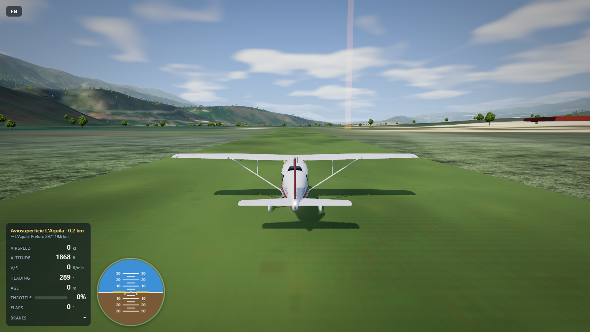
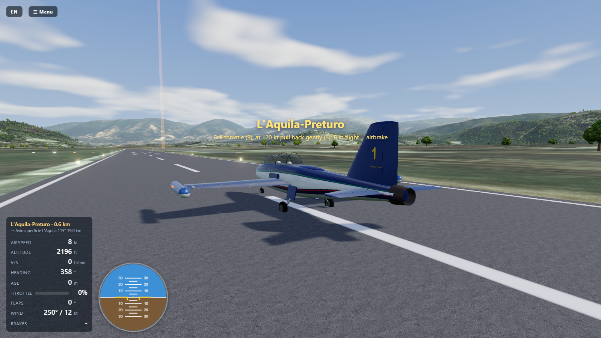
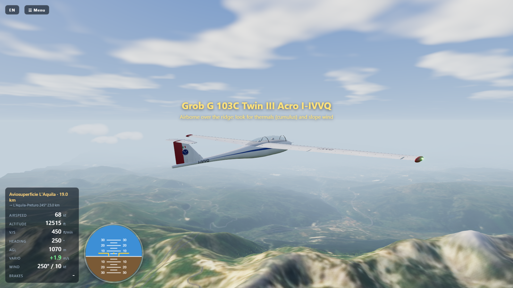
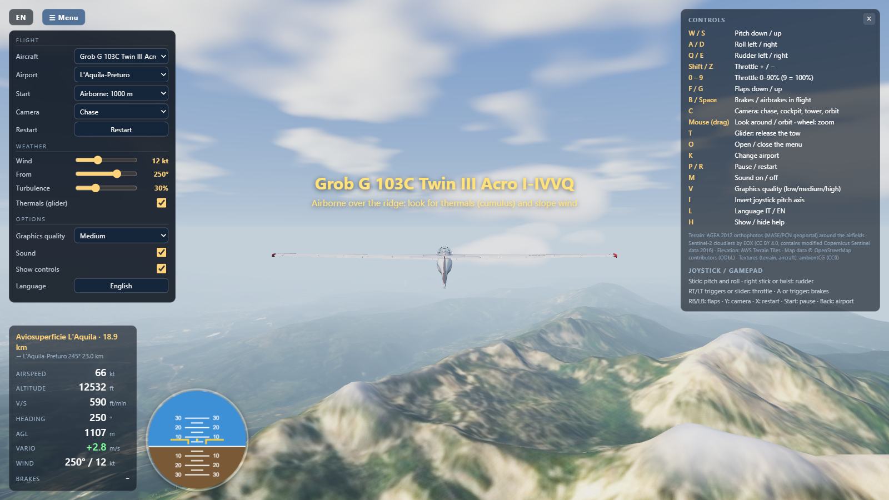
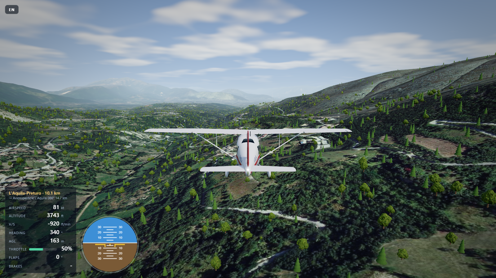

<div align="center">

# ✈️ VolareSIM

**A civil flight simulator built with [Three.js](https://threejs.org/) and Electron** — fly **three aircraft** — a Cessna 172, an Aermacchi **MB-339 of the Frecce Tricolori** and a **Grob G 103C Twin III Acro glider** (I-IVVQ) — with **wind and thermals**, over the **real terrain of L'Aquila, Italy**: elevation data, Sentinel-2 satellite imagery and OpenStreetMap airports, from the Gran Sasso to the Aterno valley. Desktop-first: a custom PBR renderer, adaptive resolution and a Windows installer.

[](https://threejs.org/)
[](https://vitejs.dev/)
[](https://www.electronjs.org/)


**English** · [Italiano](README.it.md)


</div>

## Highlights

| | |
|---|---|
| ✈️ **Three aircraft** | *Cessna 172* (propeller, 3D cockpit), *Aermacchi MB-339 PAN* (jet trainer, 17.8 kN, airbrake, retractable gear, Frecce Tricolori livery) and the aerobatic two-seat *Grob G 103C Twin III Acro* glider, registration **I-IVVQ** (17.5 m span, aero-tow, airbrakes, acoustic vario). Pick from the menu; each has its own flight model |
| 💨 **Wind & thermals** | Adjustable wind speed and direction, turbulence, ridge lift on windward slopes and **thermals above the biggest massifs** (found automatically from the terrain, drifting with the wind, marked by cumulus clouds) for the glider |
| ☰ **Drop-down menu** | Aircraft, airport, start (runway or airborne at 500–3000 m over the ridge), camera, wind, turbulence, thermals, graphics quality, sound, language, and a switch to **hide the controls panel** (also <kbd>H</kbd>) — everything is remembered between sessions |
| 🛩️ **A real airframe, not boxes** | Lofted fuselage with real window openings and an inner shell, tapered NACA 2412 wing with dihedral, hinged flaps, ailerons, elevators and rudder, wheel pants, twisted propeller, navigation lights and strobes, registration painted on the skin |
| 🎛️ **3D cockpit** | Instrument panel with working airspeed, attitude, altimeter, heading, vertical speed and RPM dials, radio stack and GPS, two linked yokes, throttle and mixture, seats, door panels. Look around with the mouse, zoom with the wheel |
| 🌅 **Physically based rendering** | HDR pipeline, ACES tone mapping, bloom, reflections from an image-based sky environment, texel-snapped sun shadows that even fall inside the cabin |
| 🗺️ **Real terrain of L'Aquila** | A 38 × 38 km area with real elevations (Gran Sasso up to 2,850 m), Sentinel-2 satellite colours, roads, rivers and lakes from OpenStreetMap, and land-cover classes (forest, urban, rock, water) estimated from the imagery. Close up, photographic CC0 textures add grain |
| 🌲 **Forests** | Textured conifers and broadleaf trees placed where the satellite shows forest; far trees become cheap billboard impostors rendered from the real 3D models |
| 🌍 **Two real airfields** | *L'Aquila-Preturo* (LIAP, runway 18/36, 1,410 m, 2,200 ft) and the grass *Aviosuperficie L'Aquila* (11/29, 650 m), 19 km apart. Runways, taxiways, aprons and the surrounding ~900 buildings come from OpenStreetMap |
| ⚡ **Adaptive performance** | Detects integrated GPUs and scales render resolution (55–100 %) on the fly, then drops quality level if needed; press <kbd>V</kbd> to choose manually |
| 🔊 **Synthesized sound** | Four-cylinder engine tied to RPM, propeller, wind, tyre roll, stall horn and touchdown thump — no audio files |
| 🎮 **Keyboard, mouse, joystick, gamepad** | Plug-and-play through the Gamepad API |
| 🌐 **English & Italian** | Auto-detected; switch any time with <kbd>L</kbd> |

## Screenshots

<table>
  <tr>
    <td width="50%"><br><sub><b>The airframe</b> — lofted fuselage, window openings, painted livery, NACA wing, wheel pants and spinning prop (orbit camera)</sub></td>
    <td width="50%"><br><sub><b>3D cockpit</b> — real window frames, instrument dials, radio stack, linked yokes, throttle and mixture</sub></td>
  </tr>
  <tr>
    <td width="50%"><br><sub><b>Ready for takeoff</b> — HUD, artificial horizon and the built-in help (<kbd>H</kbd>)</sub></td>
    <td width="50%"><br><sub><b>Aviosuperficie L'Aquila</b> — the real grass airstrip (runway 11/29) at 1,870 ft</sub></td>
  </tr>
  <tr>
    <td width="50%"><br><sub><b>Aermacchi MB-339 PAN</b> — Frecce Tricolori livery: navy gloss paint, white band with green and red pinstripes, grey belly, tricolour nose arrows, fin number</sub></td>
    <td width="50%"><br><sub><b>Grob G 103C Twin III Acro</b> (I-IVVQ) soaring over the massif, with variometer and wind in the HUD</sub></td>
  </tr>
  <tr>
    <td colspan="2"><br><sub><b>Options menu</b> — aircraft, airport, start altitude, wind, turbulence, thermals, quality, sound, controls panel on/off</sub></td>
  </tr>
  <tr>
    <td colspan="2"><br><sub><b>Comune di Lucoli</b> — 1–3 m/px AGEA orthophotos: real roads, hairpins, villages and fields</sub></td>
  </tr>
  <tr>
    <td colspan="2"><br><sub><b>Final approach</b> with flaps at 20° — shown with the Italian interface</sub></td>
  </tr>
</table>

## Install (Windows)

Download **`VolareSIM-Setup-<version>.exe`** (installer) or **`VolareSIM-Portable-<version>.exe`** (no installation) from the [Releases](../../releases) page.
Windows SmartScreen may warn about an unsigned app: choose *More info → Run anyway*. Press <kbd>F11</kbd> for fullscreen.

The app targets the GPU through Chromium/ANGLE (Direct3D 11). On laptops with two GPUs it asks for the high-performance one; you can also force it in *Windows Settings → Graphics*.

### Run from source

```bash
git clone https://github.com/marcko80/VolareSIM.git
cd VolareSIM
npm install
npm run app          # build + run the Electron app
npm run dev          # Vite dev server (http://localhost:5173) for development
npm run dist         # create installer + portable build in release/
npm run fetch-data   # re-download the real terrain data (needs internet)
node tools/fetch-ortho.mjs   # re-download the 50 cm AGEA orthophotos around the two airfields
```

## How to fly

1. Press <kbd>9</kbd> for full throttle.
2. At about **55 kt**, pull back gently (<kbd>S</kbd>) and let the plane lift off.
3. Climb at **70–80 kt**. Retract the flaps (<kbd>G</kbd>) if you used them.
4. To land, reduce power, extend flaps (<kbd>F</kbd>), fly the approach at about 65 kt, and flare just above the runway. The sim grades your touchdown by sink rate (smooth, good or hard); a violent impact or touching the ground with a wing is a crash — press <kbd>R</kbd> to restart.

**Jet (MB-339):** full throttle, rotate at ~120 kt, <kbd>B</kbd> in flight = airbrake; the gear retracts by itself. **Glider:** you start on the runway with a simplified aero-tow (release automatically at 500 m or with <kbd>T</kbd>); trim speed ~60 kt, <kbd>B</kbd> in flight = airbrakes. Look for thermals (cumulus clouds, green positive vario) and ridge lift on slopes facing the wind. Or choose *Start → Airborne* in the menu to begin at 500–3000 m over a massif.

### Controls

| Key | Action |
|---|---|
| <kbd>W</kbd> / <kbd>S</kbd> | Pitch down / up |
| <kbd>A</kbd> / <kbd>D</kbd> | Roll left / right |
| <kbd>Q</kbd> / <kbd>E</kbd> | Rudder left / right |
| <kbd>Shift</kbd> / <kbd>Z</kbd> | Increase / decrease throttle |
| <kbd>0</kbd>–<kbd>9</kbd> | Set throttle directly (0 = idle, 9 = full) |
| <kbd>F</kbd> / <kbd>G</kbd> | Flaps down / up (0°, 10°, 20°, 30°) |
| <kbd>B</kbd> / <kbd>Space</kbd> | Wheel brakes (airbrakes in flight on jet and glider) |
| <kbd>C</kbd> | Cycle camera: chase → cockpit → tower → orbit |
| Mouse drag / wheel | Look around (orbit in orbit view) / zoom |
| <kbd>T</kbd> | Glider: release the tow |
| <kbd>O</kbd> | Open / close the options menu |
| <kbd>K</kbd> | Switch to the other airport |
| <kbd>P</kbd> / <kbd>R</kbd> | Pause / restart |
| <kbd>M</kbd> | Sound on / off |
| <kbd>V</kbd> | Graphics quality: low / medium / high |
| <kbd>I</kbd> | Invert joystick pitch axis |
| <kbd>L</kbd> | Language EN / IT |
| <kbd>H</kbd> | Show / hide the help panel |

**Gamepad** (standard mapping): left stick = pitch/roll, right stick = rudder, RT/LT = throttle, A = brakes, RB/LB = flaps, Y = camera, X = restart, Start = pause, Back = airport.
**Joystick** (e.g. Logitech Extreme 3D): X/Y = roll/pitch, twist = rudder, slider = throttle, trigger = brakes, buttons 3/4 = flaps down/up, button 2 = camera.

## Graphics quality

| Level | Pipeline | Intended for |
|---|---|---|
| **Low** | direct rendering, 1024² shadows, shorter tree and LOD distances, simplified terrain shader | weak or integrated GPUs |
| **Medium** | HDR render target, bloom, ACES, SMAA, 2048² shadows | default on most GPUs |
| **High** | as Medium with 4× MSAA, vignette and grading, 4096² shadows, tree shadows near the plane, full terrain detail | high-end GPUs (default on RTX / Radeon RX 5000+) |

Measured on a hybrid laptop at 1920 × 1080 with `node tools/perf.mjs` (NVIDIA GTX 1050): Low holds 60 fps, Medium 46–60 fps and High about 35–42 fps. The simulator also detects the GPU, asks Windows for the high-performance one, and scales the render resolution between 55 % and 100 % on the fly to keep the frame rate; the HUD stays crisp. Use <kbd>V</kbd> to pick a level.

## Under the hood

| Area | Details |
|---|---|
| **Aircraft & atmosphere** (`src/specs.js`, `src/atmosphere.js`, `src/jet.js`, `src/glider.js`) | One flight model parametrised per aircraft (mass, wing area, lift slope, polar, thrust, control power): MB-339 5,000 kg / 19.3 m² / 17.8 kN with wave drag above M 0.74; glider 580 kg / 17.52 m², L/D ≈ 36, stall ≈ 40 kt, aero-tow. Aerodynamics use the airspeed relative to the air mass: surface wind with a boundary-layer profile, turbulence, ridge lift (wind · slope gradient) and thermals. Thermal sources are the maxima of the terrain smoothed over ~2 km, with a life cycle, tilted by the wind. The 3D models are original procedural builds sized from the published dimensions and checked against reference photographs; livery is texture + decals, paint is clear-coated PBR. |
| **Flight dynamics** (`src/flight.js`) | Fixed 120 Hz step. 1100 kg, 16.2 m² wing, 135 kW with 0.78 propeller efficiency and 3.4 kN static thrust. Lift slope 5 per radian, stall at 17° angle of attack with a smooth post-stall drop; flaps shift the zero-lift angle and add drag. Pitch stiffness grows near the stall, so you stall by getting too slow rather than by pulling the stick. Tricycle gear with three contact points, rolling friction, brakes, nose-wheel steering. Typical numbers: take-off roll ≈ 250 m, rotation 55 kt, climb ≈ 800 ft/min, clean stall ≈ 45 kt, top speed ≈ 140 kt. |
| **Airframe** (`src/geometry.js`, `src/aircraft.js`) | Fuselage = 170 super-elliptical rings × 88 segments lofted from monotone-cubic keyframes. Wings, tail, fin and propeller blades come from one NACA 4-digit lifting-surface builder with taper, dihedral, twist, rounded tips and hinged trailing-edge pieces whose pivots sit on the hinge line. |
| **Window openings & livery** (`src/livery.js`) | A 2048 × 1024 texture set is computed once from signed-distance functions in fuselage space: paint, anti-aliased window alpha, glass alpha, gaskets, panel lines and the registration. The same mask cuts the exterior skin and an inset interior shell, so the cabin is a real enclosed volume you can see into and out of. |
| **Cockpit** (`src/cockpit.js`) | Extruded dash, panel texture, seven dial canvases redrawn only when their value changes, chrome bezels and glass covers, two yokes that mirror stick input, throttle knob, seats, door trim and a cabin light. |
| **Sky & lighting** (`src/sky.js`) | Atmospheric gradient, HDR sun disc and a cloud layer in one fragment shader; the same shader is baked to a PMREM environment map for reflections. Sun shadows are snapped to shadow-map texels to avoid shimmering. |
| **Real data** (`tools/fetch-data.mjs`, `src/data.js`) | A one-off script downloads AWS Terrain Tiles (elevation), EOX Sentinel-2 cloudless 2016 (imagery) and Overpass/OpenStreetMap features, reprojects them to a local metric grid centred on the LIAP runway and writes `public/data/` (a 2048² height grid, a 3072² sharpened image, 1536² land-cover classes and an OSM JSON). High-resolution inset photos come from `tools/fetch-ortho.mjs` (AGEA 2012 orthophotos: 1 m/px around LIAP and over the villages of Lucoli, 2–3 m/px over 8 km around LIAP, around the grass airfield and over the whole municipality of Lucoli), blended into the terrain shader over the satellite base. The game reads these files at start-up. |
| **Terrain** (`src/world.js`) | 24 × 24 chunks of 1.6 km on a budgeted queue (no hitches while flying), three LODs with skirts. A fragment shader takes the colour from the satellite, adds luminance grain from CC0 photo textures, a tileable noise texture at 3 scales and normal maps up close, then layers roads, water, rock on steep slopes and snow above 2,300 m. Trees are instanced per chunk: 3D models near, impostor billboards farther out. |
| **Post-processing** (`src/postfx.js`) | EffectComposer: HDR half-float target → bloom → ACES output → SMAA or MSAA + grading. |
| **Audio / input / i18n** | WebAudio synthesis (`src/audio.js`), keyboard + Gamepad API (`src/controls.js`), dictionary-based IT/EN (`src/i18n.js`). |

```
VolareSIM/
├── index.html             # HUD, help and loading screen markup
├── src/
│   ├── data.js            # real elevation, land cover and OSM data loading
│   ├── main.js            # renderer, cameras, game loop, adaptive quality
│   ├── flight.js          # flight + ground physics
│   ├── geometry.js        # lofting, airfoils, lifting surfaces
│   ├── livery.js          # fuselage textures (paint, windows, interior)
│   ├── aircraft.js        # Cessna model and animation
│   ├── jet.js, glider.js  # MB-339 PAN and Grob Twin III Acro models
│   ├── specs.js           # per-aircraft flight data
│   ├── atmosphere.js      # wind, turbulence, ridge lift, thermals
│   ├── menu.js            # drop-down options menu
│   ├── cockpit.js         # 3D cockpit
│   ├── world.js           # terrain, trees, airports
│   ├── sky.js             # sky shader, environment map
│   ├── postfx.js          # post-processing
│   ├── controls.js        # keyboard / gamepad
│   ├── audio.js           # synthesized sound
│   ├── hud.js             # HUD and attitude indicator
│   └── i18n.js            # translations
├── electron/main.cjs      # desktop shell (GPU flags, fullscreen)
├── tools/                 # fetch-data (real terrain), screenshots, profiler, FPS benchmark, smoke test
├── dev/viewer.html        # stand-alone aircraft model viewer
└── .github/workflows/release.yml   # builds the Windows installer on tags
```

## Development

```bash
npm run dev           # dev server with hot reload (open /dev/viewer.html for the aircraft viewer)
npm run build         # production build to dist/
npm run screenshots   # capture docs/screenshots through Electron
node tools/perf.mjs   # FPS at every quality level
node tools/profile.mjs 1920 1080 0 1   # cost of sky / terrain / trees / shadows
node tools/smoke.mjs  # take off, switch cameras/quality/airport/language, report JS errors
npm run dist          # Windows installer + portable build
```

Pushing a tag such as `v0.5.0` makes GitHub Actions build the installer and attach it to the release.

## Roadmap

- Rain/clouds weather, lakes and rivers
- Navigation: waypoints, radio aids, a simple autopilot
- More aircraft and a `.glb` model pipeline (no freely licensed, adaptable models of the MB-339 or Twin III were found; the ones listed online are royalty-free with redistribution limits)
- More airports, a night mode with lit windows and runway lights

## Credits

Inspired by [web-flight-simulator](https://github.com/dimartarmizi/web-flight-simulator), reimagined for civil aviation. Built with [Three.js](https://threejs.org/), [Vite](https://vitejs.dev/) and [Electron](https://www.electronjs.org/).

**Data**: orthophotos © AGEA 2012 (50 cm), served by the Italian Ministry of Environment national geoportal WMS (no usage restrictions declared; `tools/fetch-ortho.mjs`), satellite imagery © [EOX IT Services GmbH](https://s2maps.eu) (Sentinel-2 cloudless 2016, CC BY 4.0, contains modified Copernicus Sentinel data), elevation from [AWS Terrain Tiles](https://registry.opendata.aws/terrain-tiles/), map data © [OpenStreetMap contributors](https://www.openstreetmap.org/copyright) (ODbL). Land-cover classes are an automatic estimate and will not match reality everywhere. See `public/data/CREDITS.txt`.

Terrain, tree and runway textures are CC0 scans from [ambientCG](https://ambientcg.com): Grass 004, Grass 001, Ground 037, Ground 106, Ground 111, Rock 051, Bark 014, Leaf 001, Pine Needles 001 and Asphalt 031; aircraft: Metal 012, Leather 026, Carpet 001, Plastic 018 B and Fabric 061 (see `public/textures/CREDITS.txt`). The livery (fin logo, Italian flag, VolareSIM cowl wordmark, I-VOLA registration on the fuselage and wings) is projected as decals (`src/decals.js`). The airframe skin (panel seams, rivet rows, grime, chipped paint, livery stripes) is generated in a shader (`src/materials.js`).
