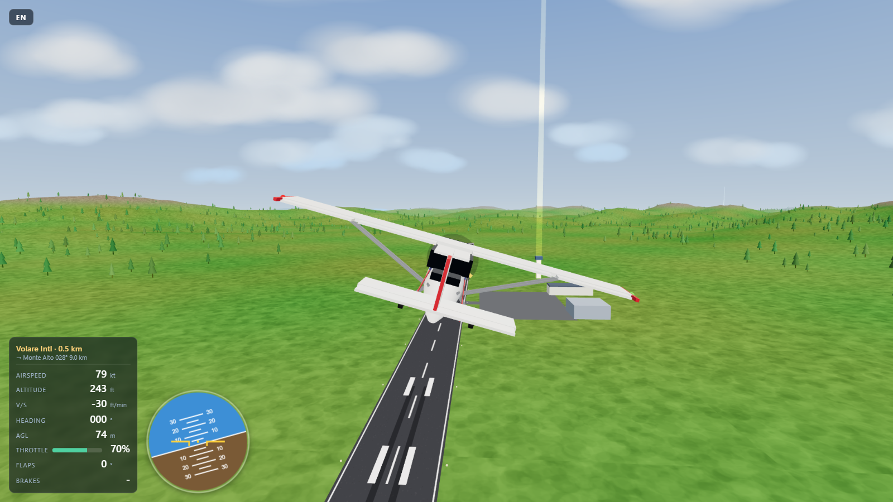
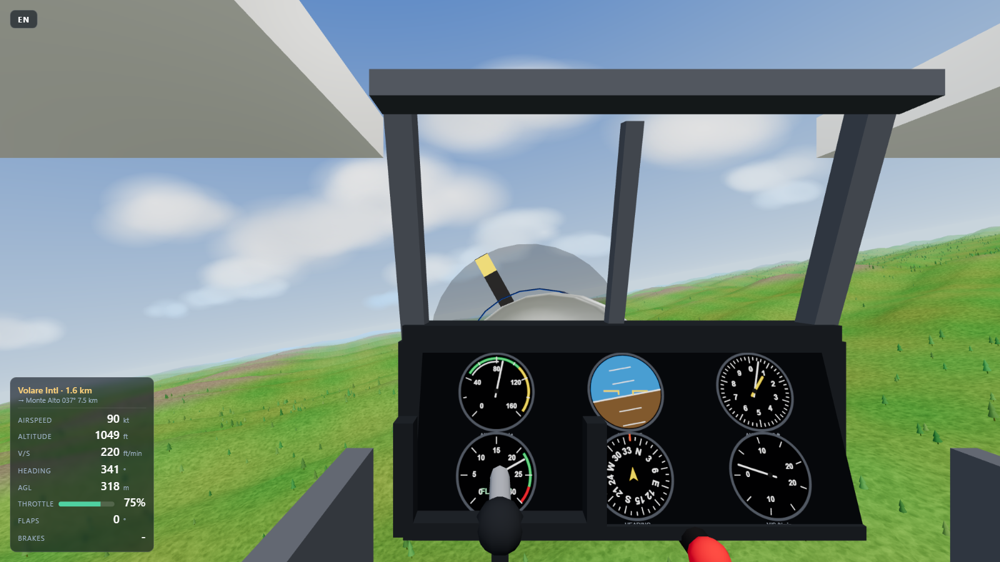
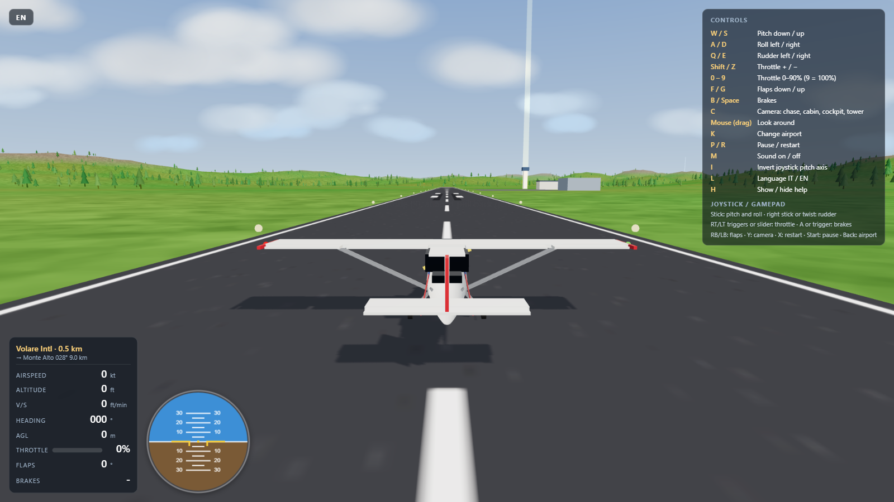

<div align="center">

# ✈️ VolareSIM

**A simple civil flight simulator built with [Three.js](https://threejs.org/)** — fly a Cessna-style single-engine plane between two airports, in your browser or as a Windows desktop app.

[](https://threejs.org/)
[](https://vitejs.dev/)
[](https://www.electronjs.org/)


**English** · [Italiano](README.it.md)



</div>

## Highlights

| | |
|---|---|
| 🛩️ **Flight model** | Thrust, drag, lift, stall, flaps, brakes and nose-wheel steering — tuned to feel like a light single-engine trainer |
| 🌍 **Two airports** | *Volare Intl* (sea level, 1200 m runway) and *Monte Alto* (90 m elevation, 900 m runway at heading 060°), about 9 km apart, with towers, hangars, lights and beacons |
| 🎥 **Four cameras** | Chase, cabin, **3D cockpit** with working instruments, and control tower. Drag the mouse to look around |
| 🔊 **Synthesized sound** | Four-cylinder engine tied to RPM, propeller, wind, tyre roll, stall horn and touchdown thump — no audio files needed |
| 🎮 **Keyboard, mouse, joystick, gamepad** | Plug-and-play through the browser Gamepad API |
| 🌐 **English & Italian** | Auto-detected; switch any time with <kbd>L</kbd> or the button in the top-left corner |
| 🖥️ **Desktop installer** | Windows installer and portable build, generated with Electron |

## Screenshots

<table>
  <tr>
    <td width="50%"><br><sub><b>3D cockpit</b> — airspeed, attitude, altimeter, RPM, heading and vertical speed; the yoke follows your inputs</sub></td>
    <td width="50%"><br><sub><b>Ready for takeoff</b> — HUD, artificial horizon and the built-in controls help (<kbd>H</kbd>)</sub></td>
  </tr>
  <tr>
    <td width="50%"><br><sub><b>Monte Alto</b> — a second airfield at 295 ft with its own runway, tower and beacon</sub></td>
    <td width="50%"><br><sub><b>Final approach</b> with flaps at 20° — shown with the Italian interface</sub></td>
  </tr>
</table>

## Quick start

### Play in the browser

```bash
git clone https://github.com/marcko80/VolareSIM.git
cd VolareSIM
npm install
npm run dev          # open http://localhost:5173
```

Any modern browser with WebGL 2 works (Chrome, Edge, Firefox, Safari).

### Windows app

Download **`VolareSIM-Setup-<version>.exe`** (installer) or **`VolareSIM-Portable-<version>.exe`** (no installation) from the [Releases](../../releases) page.
Windows SmartScreen may warn about an unsigned app: choose *More info → Run anyway*. Press <kbd>F11</kbd> for fullscreen.

To build it yourself:

```bash
npm run app          # run the Electron app from source
npm run dist         # create installer + portable build in release/
```

## How to fly

1. Press <kbd>9</kbd> for full throttle.
2. At about **55 kt**, pull back gently (<kbd>S</kbd>) and let the plane lift off.
3. Climb at **70–80 kt**. Retract the flaps (<kbd>G</kbd>) if you used them.
4. To land, reduce power, extend flaps (<kbd>F</kbd>), fly the approach at about 65 kt, and flare just above the runway. The sim grades your touchdown by sink rate (smooth, good or hard); a violent impact or touching the ground with a wing is a crash — press <kbd>R</kbd> to restart.

### Controls

| Key | Action |
|---|---|
| <kbd>W</kbd> / <kbd>S</kbd> | Pitch down / up |
| <kbd>A</kbd> / <kbd>D</kbd> | Roll left / right |
| <kbd>Q</kbd> / <kbd>E</kbd> | Rudder left / right |
| <kbd>Shift</kbd> / <kbd>Z</kbd> | Increase / decrease throttle |
| <kbd>0</kbd>–<kbd>9</kbd> | Set throttle directly (0 = idle, 9 = full) |
| <kbd>F</kbd> / <kbd>G</kbd> | Flaps down / up (0°, 10°, 20°, 30°) |
| <kbd>B</kbd> / <kbd>Space</kbd> | Wheel brakes |
| <kbd>C</kbd> | Cycle camera: chase → cabin → cockpit → tower |
| Mouse drag | Look around |
| <kbd>K</kbd> | Switch to the other airport |
| <kbd>P</kbd> / <kbd>R</kbd> | Pause / restart |
| <kbd>M</kbd> | Sound on / off |
| <kbd>I</kbd> | Invert joystick pitch axis |
| <kbd>L</kbd> | Language EN / IT |
| <kbd>H</kbd> | Show / hide the help panel |

**Gamepad** (standard mapping): left stick = pitch/roll, right stick = rudder, RT/LT = throttle, A = brakes, RB/LB = flaps, Y = camera, X = restart, Start = pause, Back = airport.
**Joystick** (e.g. Logitech Extreme 3D): X/Y = roll/pitch, twist = rudder, slider = throttle, trigger = brakes, buttons 3/4 = flaps down/up, button 2 = camera.

## Under the hood

| Area | Details |
|---|---|
| **Flight dynamics** (`src/flight.js`) | Fixed 120 Hz step. 1100 kg, 16.2 m² wing, 135 kW with 0.78 propeller efficiency and 3.4 kN static thrust. Lift slope 5 per radian with stall at 17° angle of attack and a smooth post-stall drop; flaps shift the zero-lift angle and add drag. Pitch stiffness grows near the stall, so you stall by getting too slow rather than by pulling the stick. Air density falls off with altitude. |
| **Ground handling** | Tricycle gear with three contact points, rolling friction (0.02 on the runway, 0.09 on grass), wheel brakes, speed-dependent nose-wheel steering and a tail-strike pitch limit. |
| **Typical numbers** | Takeoff roll ≈ 250 m, rotation at 55 kt, climb ≈ 800 ft/min, clean stall ≈ 45 kt, top speed ≈ 140 kt. |
| **World** (`src/world.js`) | 26 × 26 km procedural terrain (400 × 400 mesh) with hills, forests, clouds, fog, an analytic sky shader and shadows that follow the plane. Terrain is flattened around each airport. |
| **Aircraft** (`src/aircraft.js`) | Procedural Cessna with a lathe-turned fuselage, animated ailerons, flaps, elevator and rudder, navigation lights, strobes and a spinning propeller. |
| **Cockpit** (`src/cockpit.js`) | Instrument panel drawn on a canvas texture every other frame; the yoke and throttle knob mirror your inputs. |
| **Audio** (`src/audio.js`) | WebAudio oscillators and filtered noise; engine firing frequency = RPM / 60 × 2. |
| **Input** (`src/controls.js`) | Keyboard with smoothed control surfaces; Gamepad API with dead zone and expo curves. |
| **i18n** (`src/i18n.js`) | Dictionary-based IT/EN, remembered in `localStorage`. |

```
VolareSIM/
├── index.html             # HUD and help markup
├── src/
│   ├── main.js            # scene, cameras, game loop
│   ├── flight.js          # flight + ground physics
│   ├── world.js           # terrain, airports, sky
│   ├── aircraft.js        # Cessna model
│   ├── cockpit.js         # 3D cockpit
│   ├── controls.js        # keyboard / gamepad
│   ├── audio.js           # synthesized sound
│   ├── hud.js             # HUD and attitude indicator
│   └── i18n.js            # translations
├── electron/main.cjs      # desktop shell
├── tools/screenshots.mjs  # regenerates docs/screenshots
└── .github/workflows/release.yml   # builds the Windows installer on tags
```

## Development

```bash
npm run dev           # dev server with hot reload
npm run build         # production build to dist/
npm run screenshots   # rebuild and capture docs/screenshots through Electron
npm run dist          # Windows installer + portable build
```

Pushing a tag such as `v0.4.0` makes GitHub Actions build the installer and attach it to the release.

## Roadmap

- Wind and weather, lakes and rivers
- Navigation: waypoints, radio aids, a simple autopilot
- More aircraft (twin-engine, light jet) and a proper 3D model pipeline (`.glb`)
- More airports and a night mode

## Credits

Inspired by [web-flight-simulator](https://github.com/dimartarmizi/web-flight-simulator), reimagined for civil aviation. Built with [Three.js](https://threejs.org/), [Vite](https://vitejs.dev/) and [Electron](https://www.electronjs.org/).
